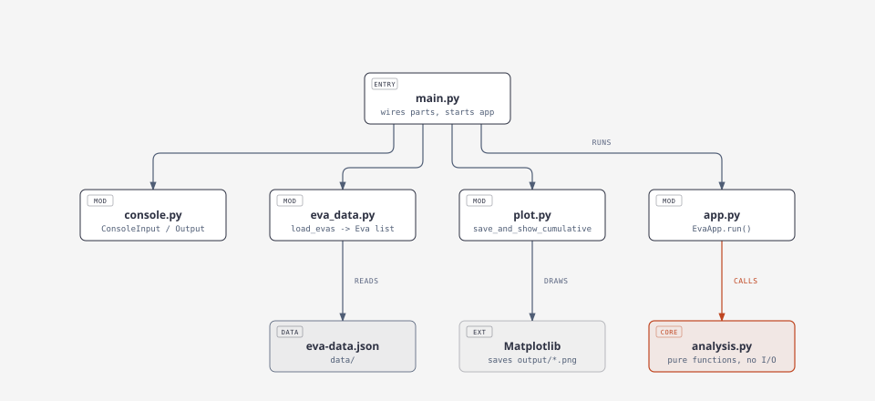

# EVA analysis

Gives a country's total EVA hours, splits EVAs into Short/Standard/Long, plots cumulative EVA time and compares two countries over a year range.

## Set up and run the application

Needs Python 3 and matplotlib.

```bash
python3 -m venv .venv
.venv/bin/pip install -r requirements.txt
.venv/bin/python src/main.py
```

Enter `data/eva-data.json`, then a country (USA or Russia). The plot saves to `output/` - close it, then enter Country A, Country B, a start year and an end year. Bad input is asked again.

## Understand its module structure



## Identify the principal responsibilities

- `src/main.py` - builds the real parts and starts the app
- `src/app.py` - runs the steps in order
- `src/analysis.py` - all calculations, no input/output
- `src/eva_data.py` - loads the JSON into EVA records
- `src/console.py` - prompts, checking answers and printing
- `src/plot.py` - the plot

## Run the automated tests

```bash
python3 -m unittest discover tests -v
```

No matplotlib or typing needed.

## Locate the architectural decision records

- `docs/docx/activity2-ADR-001-split-into-modules.docx` - splitting up the script (Activity 2)
- `docs/docx/activity5-ADR-002-testable-analysis.docx` - making the analysis testable (Activity 5)

The other activity write-ups are in `docs/docx/`.
